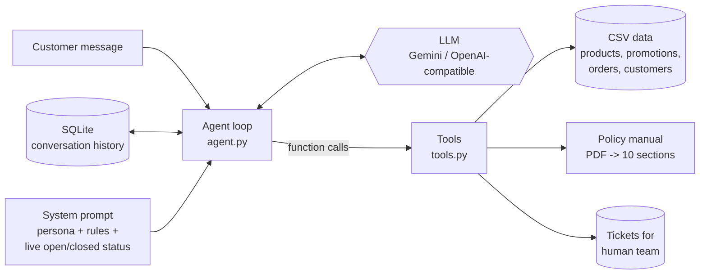

# Empório da Música — AI Customer-Service Agent

Prototype of **Tom**, a text-message (WhatsApp-style) customer-service agent for *Empório da Música*, a
musical-instrument store in Campo Grande/MS. Tom answers recurring questions (catalog, prices, availability,
promotions, order status, returns, hours, payment, shipping, warranty), knows **when to query data and when
to read the policy manual**, and politely handles out-of-scope requests.

```
Cliente: Quanto custa o Takamine GD20? Se eu pagar no PIX tem desconto?
  [tool] get_product_details({"product": "Takamine GD20"})
  [tool] get_store_policy({"topics": ["pagamento"]})
Tom:     O Takamine GD20 Dreadnought tá saindo por R$ 2.199,00 ... no PIX fica R$ 2.089,05 (5% off) ...
```

- **Stack:** Python 3.10+, function calling (no agent framework), Google Gemini (free tier) or any
  OpenAI-compatible API, SQLite for conversation memory, `pytest`.
- **Example conversations:** [`conversations/`](conversations/) (5 real, unedited transcripts).
- **Routing eval:** [`evals/routing_results.md`](evals/routing_results.md).

---

## 1. How to run

### Requirements
- Python **3.10+**
- An LLM API key. The default is **Google Gemini**, which has a free tier:
  create a key at <https://aistudio.google.com/apikey> (no credit card needed).

### Setup
```bash
git clone <this-repo-url> && cd emporio-da-musica-agent
python -m venv .venv
# Windows: .venv\Scripts\activate    |  macOS/Linux: source .venv/bin/activate
pip install -r requirements.txt
cp .env.example .env        # then edit .env and set GEMINI_API_KEY
```

### Chat with the agent (CLI)
```bash
python -m emporio_agent --debug              # --debug prints every tool call
python -m emporio_agent --session 67998123456 # resume a conversation (history is persisted)
```
Commands inside the chat: `/novo` (reset the conversation), `/sair` (quit).

### Other providers
Everything model-specific lives in [`emporio_agent/llm.py`](emporio_agent/llm.py). Switch with environment variables:

| Provider | `.env` |
|---|---|
| Gemini (default) | `LLM_PROVIDER=gemini`, `GEMINI_API_KEY=...`, optional `GEMINI_MODEL=gemini-2.5-flash` |
| OpenAI | `LLM_PROVIDER=openai`, `OPENAI_API_KEY=...`, `OPENAI_MODEL=gpt-4o-mini` |
| Groq (free tier) | `LLM_PROVIDER=openai`, `OPENAI_BASE_URL=https://api.groq.com/openai/v1`, `OPENAI_API_KEY=...`, `OPENAI_MODEL=llama-3.3-70b-versatile` |
| Local Ollama | `LLM_PROVIDER=openai`, `OPENAI_BASE_URL=http://localhost:11434/v1`, `OPENAI_MODEL=qwen2.5:7b` |

### Tests, example conversations and eval
```bash
pytest                                  # 27 offline tests (no API key needed; the LLM is faked)
python scripts/run_conversations.py     # regenerates conversations/*.md with the real LLM
python scripts/eval_routing.py          # routing eval -> evals/routing_results.md
```

### Time
The agent uses the real clock of Campo Grande (UTC-4). The dataset, however, is a snapshot that ends around
**2026-03-22** (the latest order; order 8 is still "shipped"). To make order statuses and return windows
coherent, the example conversations, eval and tests freeze the clock with `EMPORIO_NOW=2026-03-24T10:30`.
You can do the same in `.env`.

---

## 2. Architecture



| Module | Responsibility |
|---|---|
| `store.py` | Loads and cleans the CSVs into typed records; identity lookup for customers |
| `pricing.py` | Deterministic money rules: promotions, PIX discount, installment tiers, BRL formatting |
| `clock.py` | Campo Grande time, opening hours, holidays, "open now?" |
| `policies.py` | PDF ingestion, cleanup, errata, chunking by section, topic retrieval |
| `tools.py` | The 7 tools exposed to the LLM (+ JSON schemas) |
| `prompts.py` | System prompt (persona, grounding rules, routing guide, scope) |
| `llm.py` | Neutral LLM interface + Gemini and OpenAI-compatible adapters, retry on rate limits |
| `agent.py` | Function-calling loop (max 6 steps), graceful fallback |
| `memory.py` | Per-session history in SQLite |

### Tools

| Tool | Source | Used for |
|---|---|---|
| `search_products` | CSV | "violões até R$1000", "tem guitarra Fender?", recommendations |
| `get_product_details` | CSV | price/stock/specs of one model, tolerant to typos ("takamine gd-20"); returns alternatives if unavailable |
| `list_active_promotions` | CSV | current promotions (only `is_active = 1`) |
| `lookup_orders` | CSV | order status/tracking, **only after identity check** (order + e-mail/phone) |
| `check_return_eligibility` | CSV + policy rules | regret / defect / preference exchange, with date maths done in code |
| `get_store_policy` | PDF | address, contact, hours, payment, shipping, returns, warranty, promotions rules, privacy |
| `escalate_to_human` | writes `var/tickets.jsonl` | complaints, cancellations, defects, late deliveries; returns a protocol number |

---

## 3. Technical decisions (and why)

### 3.1 Agent approach: function calling with deterministic tools (no SQL agent, no vector RAG)
The questions this store receives fall into two kinds of knowledge:

1. **Structured, changing data** (price, stock, promotions, orders). Correctness matters a lot here: the manual
   itself warns that a wrong price "pode configurar propaganda enganosa". So these are served by
   **typed Python tools** that return *already computed* facts: final price with the promotion applied,
   PIX price, maximum installments, availability label, days since delivery, eligibility of a return.
   The LLM's job is only to **choose the tool, fill arguments and phrase the answer**.
   - *Why not a text-to-SQL agent?* It would let the model write arbitrary queries over the customers table
     (privacy risk), it would push business rules (non-cumulative promotions, installment tiers, return
     windows) into prompts, and it is harder to test. With 7 narrow tools every rule has a unit test.
2. **Unstructured policies** (the 8-page manual). See 3.3.

The loop is a plain ReAct-style function-calling loop (~40 lines in `agent.py`): the model can call several
tools in one turn (e.g. product details + payment policy) and chain them (search -> details). I did not use
LangChain/LangGraph: with one agent and seven tools a framework adds indirection and hidden prompts without
adding capability, while the hand-written loop is fully visible and easy to test with a fake LLM.

**Principle used throughout: facts and rules live in code, language lives in the LLM.**

### 3.2 Model and provider: Gemini 2.5 Flash (free tier), swappable
- Free tier with no credit card, so anyone evaluating this can run it.
- Native, reliable function calling, including parallel calls; good Brazilian Portuguese; low latency
  (important for a chat channel); low cost if moved to the paid tier.
- Provider lock-in is avoided with a small neutral interface (`llm.py`). An **OpenAI-compatible adapter**
  covers OpenAI, Groq, OpenRouter and a **local Ollama** model (useful if the store does not want customer
  data leaving its machine). Temperature is 0.3: consistent answers but natural wording.
- Free tiers rate-limit, so calls retry with exponential backoff on 429/5xx.

### 3.3 Policy retrieval: section-level chunks + topic routing
The manual is small (~3k tokens) and already organized into **10 numbered sections, each one a
self-contained topic**. So:
- **Ingestion** (`policies.py`): `pypdf` extracts the text (it breaks lines between almost every word), the
  text is normalized, page headers/footers are removed, bullets and sub-headings are restored, and the text is
  split on top-level headings. A heading is only accepted if it carries the *next expected* number, so the
  numbered list inside section 7 ("1. Saudação...") does not split it by mistake.
- **Retrieval**: the `get_store_policy` tool has an **enum of topics** (hours, payment, returns, shipping,
  warranty...). The model picks the topics and receives the **verbatim** sections.

Why not embeddings + vector store? For 10 chunks, letting the LLM route by topic is exact, needs no
embedding model or index, is deterministic and easy to debug ("which section did it read?" is visible in
the trace). Putting the whole manual into the system prompt would also work at this size, but it costs
~3k tokens on every message and makes it impossible to see *whether* the agent consulted the policy, which
is an explicit requirement. If the knowledge base grew (FAQ, product manuals, hundreds of documents), I would
move to hybrid search (BM25 + embeddings) behind the same tool interface.

### 3.4 Prompt strategy
`prompts.py`. Instructions in English (models follow them most reliably), tone guide and examples in
Portuguese, and answers always in Brazilian Portuguese. Sections:
1. **Live context**: current date/time in Campo Grande and whether the store is open, computed in code on every
   turn (models don't know the time, and "vocês estão abertos?" is a top question). Includes holidays, e.g. on
   02/11 it says the store is closed for *Finados* and reopens Tuesday 09:00.
2. **Persona**: "Tom" (a musical pun, *tom* = musical key/tone). Informal but professional, WhatsApp-sized
   messages, as section 7.1 of the manual asks.
3. **Grounding rules**: never state a price, stock, promotion, date, order or policy without a tool result in
   the current conversation; copy numbers exactly as the tools return them.
4. **Routing guide**: an explicit mapping from question type to tool (data vs. policy).
5. **Presentation rules from the manual**: a promotional price is always shown with the original price and the
   discount %, PIX discount does not stack, out-of-stock/discontinued handling.
6. **Privacy and actions**: identity check before order data; no cancellations/refunds/discounts by the bot
   (they go to `escalate_to_human`).
7. **Scope and safety**: instruments only (no accessories, no made-up partner stores), unrelated topics are
   declined, prompt-injection attempts are ignored.

Tool descriptions are part of the prompt, so they say *when* to use each tool, not only what it does.

### 3.5 Interface: CLI
The focus is the agent's behavior, so a CLI with a `--debug` flag that prints every tool call is the most
transparent interface. `Agent.reply(session_id, text)` is channel-agnostic: a WhatsApp webhook or a FastAPI
endpoint would be a thin layer on top of it.

### 3.6 Conversation persistence: SQLite, text only
Customers on WhatsApp come back later ("e aquele violão que você me mostrou?"), so history is stored per
`session_id` (in production: the customer's phone number) in SQLite (stdlib, zero setup). Only user/assistant
**text** is stored, not tool payloads: prices and stock change, so they are fetched again on each turn instead of
being trusted from an old transcript. The window is the last 20 messages, to bound cost and context.

### 3.7 Privacy (LGPD) and safety
- Order data is only returned when the **order number and the e-mail/phone match the same customer**.
  Otherwise the tool returns a generic "not found", so the bot never confirms that an order exists for someone else.
- Phone numbers are normalized (`(67) 99812-3456`, `+55 67 99812 3456`, `99812-3456` all match), but fewer
  than 8 digits are rejected.
- The data has **two customers sharing one e-mail** (ids 11 and 43). The lookup never assumes one identifier
  equals one person: with a shared identifier it asks for the order number instead of listing orders (regression test included).
- Only the customer's **first name** is exposed to the model, never full e-mail, phone or address.
- The bot cannot change orders or prices; those are escalated to the team.

### 3.8 Testing and evaluation
- **27 offline unit tests** (`pytest`, no API key): pricing tiers, holidays, search normalization,
  typo-tolerant matching, out-of-stock alternatives, promotions, identity checks, return windows, PDF
  parsing/errata, and the agent loop (tool round trip, history, runaway-loop and LLM-error fallbacks) with a scripted fake LLM.
- **Routing eval** (`scripts/eval_routing.py`): 15 single-turn cases checking that the agent consults the
  right source (data / policy / nothing), avoids forbidden tools, and that the answer contains the expected fact.

---

## 4. Data treatment

| Issue found | Treatment |
|---|---|
| Policy PDF: `pypdf` puts a line break between almost every word; tables are flattened | Whitespace normalization, header/footer removal, bullets and sub-headings restored, section split (see 3.3) |
| Policy PDF: contact table e-mail `contato@empóriodamusica.com.br` (accent in the domain, invalid) vs. cover `contato@emporiodamusica.com.br` | Errata at ingestion: the valid one is used |
| Policy PDF: section 7 says WhatsApp is **(67) 3321-4500**, but the company data table (1.2) and the cover say **Telefone/WhatsApp (67) 3341-4444** | Errata: the official data table wins (2 sources vs 1). **Should be confirmed with the store** |
| Payment table says credit card "parcela mínima R$ 100", section 3.1 has tiers (≤3x / 4–6x R$ 80 / 7–12x R$ 100) | The more specific section 3.1 is implemented in `pricing.py`. "Sem valor mínimo (exceto abaixo de R$ 50)" is read as "each installment ≥ R$ 50" |
| `products.status` has `active`, `discontinued`, `coming_soon` | Only `active` with stock > 0 is sellable. `discontinued` is not offered even when it has stock (id 136 has 13 units), `coming_soon` is not on sale yet |
| Product with `active` status but stock 0 (Giannini GF-3D) | "Temporarily unavailable" + similar alternatives (same category, closest price), per manual 7.3 |
| Several promotions per product, most inactive | Only `is_active = 1` counts. If a product had several active promotions, the biggest discount is used (promotions are not cumulative) |
| Categories with no products (woodwinds, brass, orchestral strings) although the manual says the store sells them | The agent says there are no options available right now and offers the team, instead of inventing products |
| Customers 11 and 43 share an e-mail | Identity check handles non-unique identifiers (3.7) |
| Order totals that don't match items × current price (e.g. order 3: 2 × R$ 1.749 ≠ R$ 3.450; order 20) | Order total is reported as recorded (prices may have changed or discounts applied); never recomputed |
| Order 9: R$ 349,90 paid in 6x (below the R$ 80 minimum) | Historical data, reported as is; the rule is enforced only for new quotes |
| No actual delivery date in the data | `estimated_delivery` of delivered orders is used as the receipt date for return windows (assumption) |
| No sales channel in orders | All orders have shipping/tracking, so they are treated as online purchases (the regret right applies) |
| Product name typo "Giannini GN-15 Nylon **Cedr**" | Kept as is (it is the catalog name); fuzzy matching still finds it |

## 5. Assumptions (ambiguities in the brief or the data)
- Customers write in Portuguese; the code, README and docs are in English, as requested by the hiring process.
- Order status meanings: `pending` = waiting for payment, `confirmed` = paid / being prepared, `shipped`,
  `delivered`, `cancelled`.
- "Troca por preferência em até 7 dias" is counted from receipt (like the regret right).
- Defect exchange directly with the store: 30 days from the **purchase** (as the manual says); legal warranty: 90
  days from **receipt**; after that the manufacturer warranty (6 months to 2 years) with the store as intermediary.
- Cancellation of orders not yet shipped is not covered by the manual, so it goes to the human team.
- Holidays: national + MS state (11/10) + Campo Grande (26/08), Good Friday and Corpus Christi.
  The real list should come from the store's calendar.
- The manual says to suggest partner stores for accessories "when possible"; there is no partner list, so the bot
  does not name any.

## 6. Known limitations and what I would do with more time
- **Evaluation at scale**: grow the routing eval into a regression suite (50–100 conversations, multi-turn), with
  LLM-as-judge for tone/faithfulness, and run it in CI on every prompt change.
- **Real channel**: a WhatsApp Business API webhook (FastAPI) using the phone number as `session_id` (which also
  makes identity verification simpler and safer), plus a hand-off inbox for the team.
- **Data access**: replace the CSV loader with the store's database/ERP (the tools only depend on `StoreData`),
  with caching and a real stock reservation check.
- **Shipping quotes**: the manual says freight is calculated from the CEP; an integration with Correios/Jadlog would
  let the bot quote it instead of only explaining the rules.
- **Observability**: structured logs of every tool call, latency and token cost; dashboards of escalation rate and
  unanswered questions to improve the catalog and the manual.
- **Retrieval**: if the knowledge base grows, hybrid search (BM25 + embeddings) with citations.
- **Guardrails**: an output check that every price/number in the answer appears in a tool result of that turn.
- **Search**: synonyms ("acústico", "folk" ↔ "aço"), and price-aware ranking by relevance instead of price only.
- Memory is a fixed window; long conversations could use a running summary.

## 7. Use of AI coding assistants
I used **Claude Code** (Anthropic's agentic coding CLI, Claude Opus model) as a pair programmer for this project.
My workflow was:
1. **Reading and analysis**: I gave it the brief, the CSVs and the PDF, and used it to profile the data and
   find inconsistencies (duplicate e-mail, conflicting phone numbers, statuses, totals) before writing any agent code.
2. **Design**: we discussed the architecture (deterministic tools vs. SQL agent, topic routing vs. vector RAG,
   framework vs. plain loop). The decisions and trade-offs in section 3 are the result of that discussion.
3. **Incremental implementation**: layer by layer (data -> pricing -> clock -> policies -> tools -> prompt -> LLM
   adapters -> loop -> CLI -> tests), with a commit per step. The commit history shows the real progression,
   including a bug found mid-way (shared e-mail) and its fix with a regression test.
4. **Verification**: every tool was smoke-tested against the real data, and the offline test suite was run after
   each change. The example conversations and the eval are generated by scripts against the real model and committed
   unedited, so they show actual behavior, mistakes included.

I reviewed the generated code and the decisions, and I am able to explain and change any part of it.

## 8. Project structure
```
emporio_agent/        agent package (see table in section 2)
data/raw/             original CSVs and policy PDF provided by the store
conversations/        5 example conversations (generated, unedited)
evals/                routing eval results
scripts/              run_conversations.py, eval_routing.py
tests/                offline test suite
```
